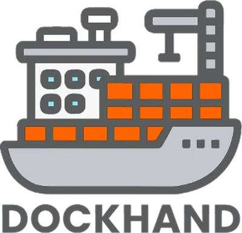
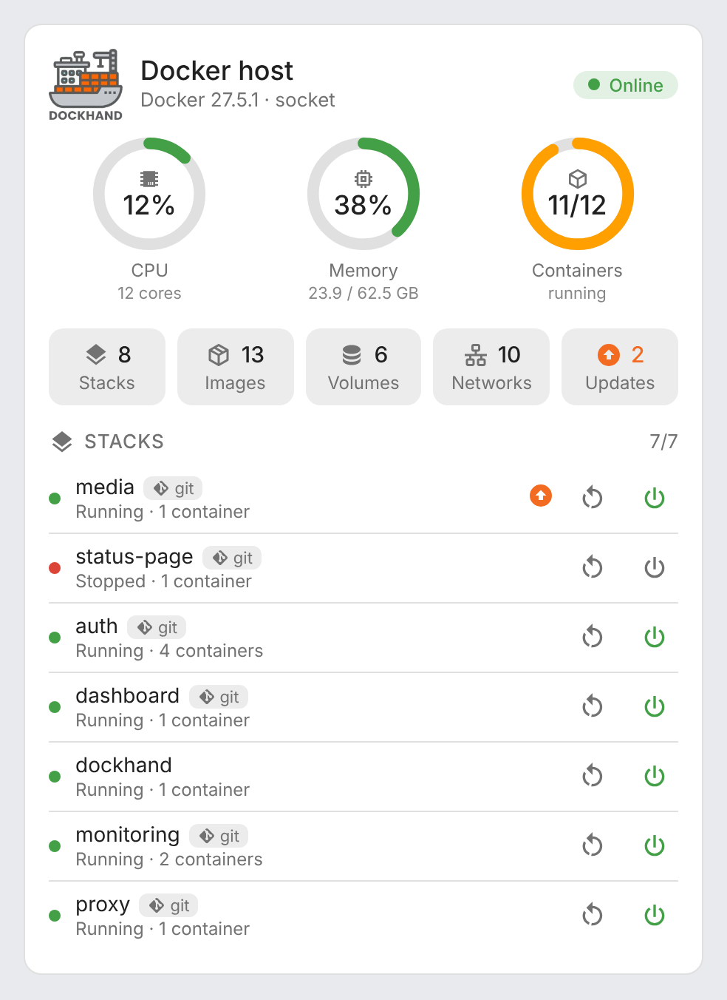
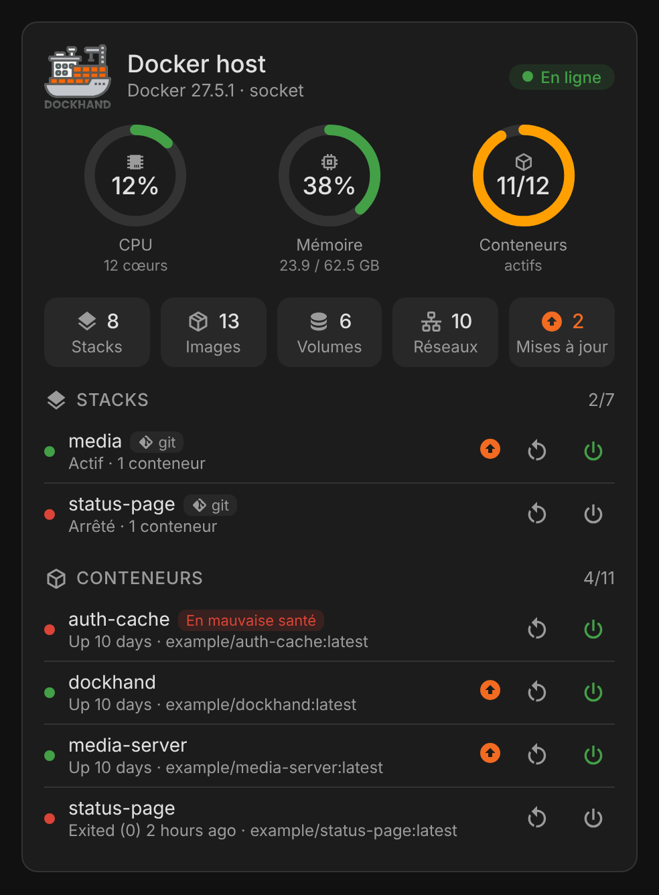
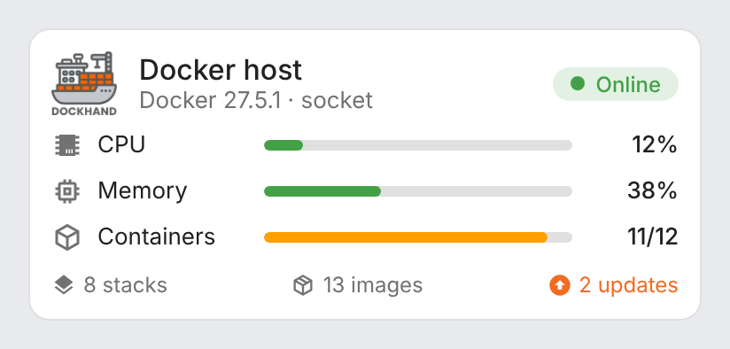
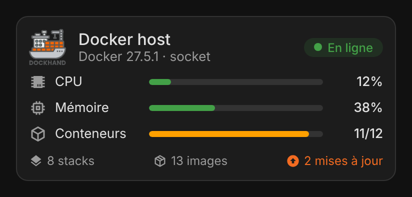
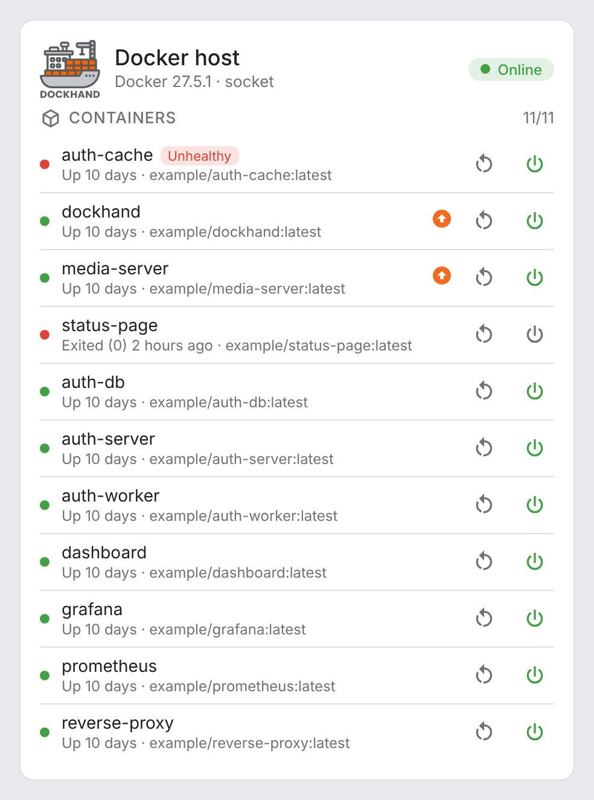

# ha-dockhand-card

[](https://github.com/hacs/integration)
[](https://github.com/juju35/ha-dockhand-card/actions/workflows/validate.yml)
[](https://github.com/juju35/ha-dockhand-card/actions/workflows/build.yml)
[](LICENSE)

<p align="center"></p>

Lovelace cards for Home Assistant to monitor and control Docker environments managed by [Dockhand](https://dockhand.pro): CPU, memory, containers, stacks and pending updates at a glance.

The cards are built on top of the [Dockhand integration](https://github.com/raetha/ha-dockhand): entities are **discovered automatically** from the Home Assistant registries, you don't have to pick them one by one, and it works whatever your Home Assistant language.

[](https://my.home-assistant.io/redirect/hacs_repository/?owner=juju35&repository=ha-dockhand-card&category=plugin)

| Dockhand Card | Dockhand Mini Card |
|---|---|
|  |  |

## Features

- Two cards: a full **Dockhand Card** and a compact **Dockhand Mini Card**
- Automatic discovery of the Dockhand environments (several environments supported)
- CPU, memory and running containers gauges, Docker version and connection type
- Stacks, images, volumes, networks and pending updates counters
- Stacks list with status, Git badge, sync errors and available updates
- Optional containers list with state, health, image and available updates
- Start / stop and restart buttons for stacks and containers (with confirmation)
- "Only items needing attention" mode: stopped, unhealthy or outdated first
- Click any value to open its Home Assistant history (more-info dialog)
- Visual editor in the dashboard UI for both cards (no YAML needed)
- Light and dark mode, English and French
- Single file, no external dependency, the Dockhand logo is embedded

## Prerequisites

The [Dockhand integration](https://github.com/raetha/ha-dockhand) must be installed and configured (available in HACS), with Home Assistant 2024.1 or later.

## Installation

### Via HACS (recommended)

Click the button below to add the repository directly:

[](https://my.home-assistant.io/redirect/hacs_repository/?owner=juju35&repository=ha-dockhand-card&category=plugin)

Then click **Download**, and reload your browser when HACS asks you to.

Or manually:

1. Open HACS → **⋮** (top right) → **Custom repositories**
2. Add `https://github.com/juju35/ha-dockhand-card` — Type: **Dashboard**
3. Search for **Dockhand Card** and click **Download**
4. Clear your browser cache and refresh

### Manual

1. Download `dockhand-card.js` from the [latest release](https://github.com/juju35/ha-dockhand-card/releases/latest) (or `dist/dockhand-card.js` from this repository)
2. Copy it to `/config/www/dockhand-card.js`
3. Go to **Settings → Dashboards → ⋮ → Resources** → Add resource:
   - URL: `/local/dockhand-card.js`
   - Type: **JavaScript Module**
4. Clear your browser cache and refresh

## Configuration

### Visual editor

Edit a dashboard, click **Add card** and search for **Dockhand Card** or **Dockhand Mini Card**. The first environment is preselected; pick another one in the list if you have several, set an optional title, choose the sections to display and the language. The preview updates live, and options left at their default are kept out of the generated YAML.

### Minimal

```yaml
type: custom:dockhand-card
```

```yaml
type: custom:dockhand-mini-card
```

### Full options

```yaml
type: custom:dockhand-card
environment: Docker host
title: Docker
show_logo: true
show_stats: true
show_counts: true
show_stacks: true
show_containers: true
show_controls: true
only_problems: false
language: fr
```

```yaml
type: custom:dockhand-mini-card
environment: Docker host
title: Docker
show_logo: true
show_updates: true
language: fr
```

### Options reference

| Option | Card | Default | Description |
|---|---|---|---|
| `environment` | both | First environment | Dockhand environment to display: its name (as shown in Dockhand) or its Home Assistant device id (set by the visual editor) |
| `title` | both | Environment name | Card title |
| `show_logo` | both | `true` | Show the Dockhand logo |
| `show_stats` | full | `true` | CPU, memory and running containers gauges |
| `show_counts` | full | `true` | Stacks, images, volumes, networks and updates counters |
| `show_stacks` | full | `true` | Stacks list |
| `show_containers` | full | `false` | Containers list |
| `show_controls` | full | `true` | Start / stop and restart buttons |
| `only_problems` | full | `false` | Only list stacks and containers that are stopped, unhealthy, out of sync or have an update |
| `show_updates` | mini | `true` | Pending updates in the footer |
| `language` | both | Auto | Force language: `fr` or `en` (auto-detects from HA settings) |

## Screenshots

| Light | Dark (French, only items needing attention) |
|---|---|
|  |  |
|  |  |

Containers list:



## How it works

The cards read the Home Assistant entity and device registries instead of entity ids: every entity of the Dockhand integration is matched by its `translation_key` (`cpu_usage`, `containers`, `status`, `restart`…) and by the device it belongs to (`Environment`, `Container`, `*Stack`). Entity ids can therefore be in any language or renamed without breaking the cards.

Some sensors of the integration are disabled by default (Docker version, host platform…). Enable them in Home Assistant to show them in the header.

The start / stop button uses the stack or container switch, and the restart button presses the integration's **Restart** button. Stopping and restarting ask for confirmation.

Thresholds:

| Value | Orange | Red |
|---|---|---|
| CPU usage | 70 % | 90 % |
| Memory usage | 80 % | 95 % |
| Containers | some are not running or unhealthy | — |

## Development

```bash
npm install
npm run build        # bundles src/dockhand-card.js + images/logo.webp into dist/dockhand-card.js
npm run check        # verifies dist/ is up to date (run in CI)
npm run screenshots  # renders the cards with mock data (scripts/mock-states.mjs) into screenshots/
```

### Releasing

1. Add a `## <version>` section at the top of [CHANGELOG.md](CHANGELOG.md)
2. Run the **Release** workflow from the Actions tab with that version

The workflow builds the card, creates the tag and the GitHub release with the changelog section as notes, and attaches `dockhand-card.js`.

## Translations

The cards auto-detect the language from your Home Assistant settings. Currently supported:

| Language | Code |
|---|---|
| English | `en` |
| Français | `fr` |

Contributions for additional languages are welcome!

## Credits

The Dockhand logo comes from the [Dockhand integration](https://github.com/raetha/ha-dockhand) (MIT). Dockhand is a project by [Finsys](https://github.com/Finsys/dockhand).

## License

[MIT](LICENSE)
