# ha-dockhand-card

[](https://github.com/hacs/integration)
[](https://github.com/juju35/ha-dockhand-card/actions/workflows/hacs.yml)
[](https://github.com/juju35/ha-dockhand-card/actions/workflows/validate.yml)
[](https://github.com/juju35/ha-dockhand-card/releases/latest)
[](LICENSE)

<p align="center"></p>

Lovelace cards for Home Assistant to monitor and control Docker environments managed by [Dockhand](https://dockhand.pro): CPU, memory, containers, stacks and pending updates at a glance.

The cards are built on top of the [Dockhand integration](https://github.com/raetha/ha-dockhand): entities are **discovered automatically** from the Home Assistant registries, you don't have to pick them one by one, and it works whatever your Home Assistant language.

[](https://my.home-assistant.io/redirect/hacs_repository/?owner=juju35&repository=ha-dockhand-card&category=plugin)

| Dockhand Card | Dockhand Mini Card |
|---|---|
|  |  |

## Features

- Two cards: a full **Dockhand Card** and a compact **Dockhand Mini Card**
- Automatic discovery of the Dockhand environments (several environments supported)
- CPU, memory and running containers gauges, Docker version and connection type
- Stacks, images, volumes, networks and pending updates counters
- Stacks list with status, Git badge, sync errors and available updates
- Optional containers list with state, health, image and available updates
- Start / stop and restart buttons for stacks and containers (with confirmation)
- "Only items needing attention" mode: stopped, unhealthy or outdated first
- Click any value to open its Home Assistant history (more-info dialog)
- Detail button at the top right of the mini card: it switches to the full card and back; a click anywhere outside the card brings the compact view back
- Visual editor in the dashboard UI for both cards (no YAML needed)
- Light and dark mode, English, French, German, Spanish and Serbian (Cyrillic and Latin)
- Single file, no external dependency, the Dockhand logo is embedded

## Prerequisites

The [Dockhand integration](https://github.com/raetha/ha-dockhand) must be installed and configured (available in HACS), with Home Assistant 2024.8 or later.

## Installation

### Via HACS (recommended)

Click the button below to add the repository directly:

[](https://my.home-assistant.io/redirect/hacs_repository/?owner=juju35&repository=ha-dockhand-card&category=plugin)

Then click **Download**, and reload your browser when HACS asks you to.

Or manually:

1. Open HACS → **⋮** (top right) → **Custom repositories**
2. Add `https://github.com/juju35/ha-dockhand-card` — Type: **Dashboard**
3. Search for **Dockhand Card** and click **Download**
4. Clear your browser cache and refresh

### Manual

1. Download `dockhand-card.js` from the [latest release](https://github.com/juju35/ha-dockhand-card/releases/latest)
2. Copy it to `/config/www/dockhand-card.js`
3. Go to **Settings → Dashboards → ⋮ → Resources** → Add resource:
   - URL: `/local/dockhand-card.js`
   - Type: **JavaScript Module**
4. Clear your browser cache and refresh

## Configuration

### Visual editor

Edit a dashboard, click **Add card** and search for **Dockhand Card** or **Dockhand Mini Card**. The first environment is preselected; pick another one in the list if you have several, set an optional title, choose the sections to display and the language. The preview updates live, and options left at their default are kept out of the generated YAML.

### Minimal

```yaml
type: custom:dockhand-card
```

```yaml
type: custom:dockhand-mini-card
```

### Full options

```yaml
type: custom:dockhand-card
environment: Docker host
title: Docker
dockhand_url: http://192.168.1.10:3000
show_logo: true
show_stats: true
show_counts: true
show_stacks: true
show_containers: true
show_controls: true
only_problems: false
expand_stacks: false
expand_containers: false
language: fr
```

```yaml
type: custom:dockhand-mini-card
environment: Docker host
title: Docker
dockhand_url: http://192.168.1.10:3000
show_logo: true
show_updates: true
zoom: true
language: fr
```

### Options reference

| Option | Card | Default | Description |
|---|---|---|---|
| `environment` | both | First environment | Dockhand environment to display: its name (as shown in Dockhand) or its Home Assistant device id (set by the visual editor) |
| `title` | both | Environment name | Card title |
| `show_logo` | both | `true` | Show the Dockhand logo |
| `dockhand_url` | both | Detected | Address opened in a new tab when clicking the logo. Defaults to the Dockhand web UI known by the integration, or [dockhand.pro](https://dockhand.pro) if none |
| `show_stats` | full | `true` | CPU, memory and running containers gauges |
| `show_counts` | full | `true` | Stacks, images, volumes, networks and updates counters |
| `show_stacks` | full | `true` | Stacks list |
| `show_containers` | full | `false` | Containers list |
| `show_controls` | full | `true` | Start / stop and restart buttons |
| `only_problems` | full | `false` | Only list stacks and containers that are stopped, unhealthy, out of sync or have an update |
| `expand_stacks` | full | `false` | Stacks list expanded when the card loads (click the section title to fold / unfold) |
| `expand_containers` | full | `false` | Containers list expanded when the card loads (click the section title to fold / unfold) |
| `show_updates` | mini | `true` | Pending updates in the footer |
| `zoom` | mini | `true` | Detail button at the top right: switches to the full card and back (`false` removes it) |
| `language` | both | Auto | Force language: `en`, `fr`, `de`, `es`, `sr`, `sr-Latn`, `it`, `nl`, `pt` or `pl` (auto-detects from HA settings) |

## Screenshots

| Light | Dark |
|---|---|
|  |  |
|  |  |
| 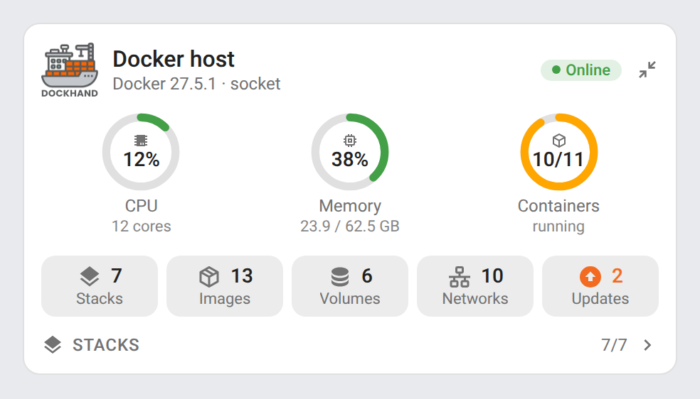 | 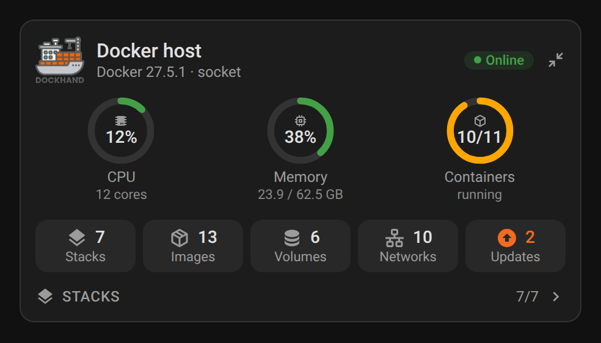 |

Only items needing attention (`only_problems: true`, containers list shown, both lists expanded):

| Light | Dark |
|---|---|
| 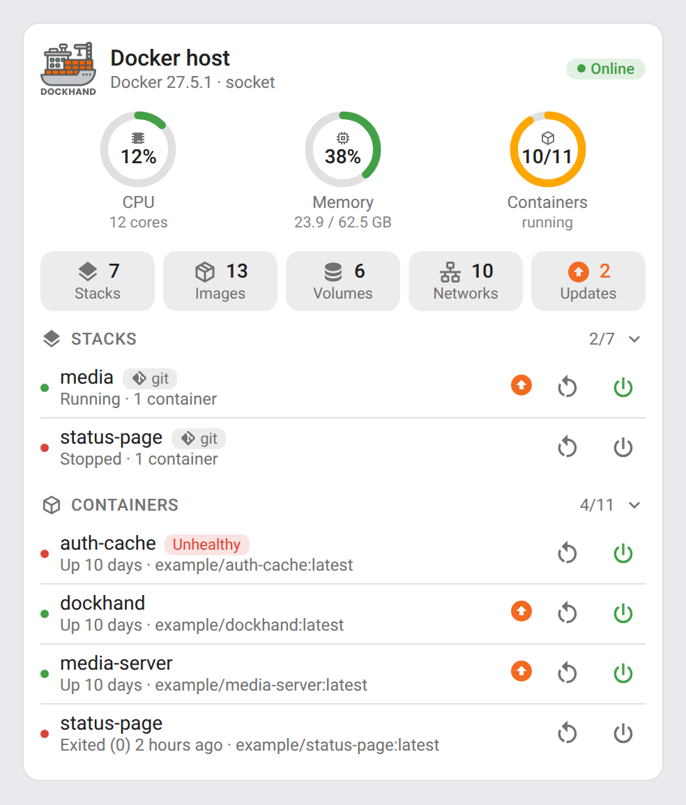 | 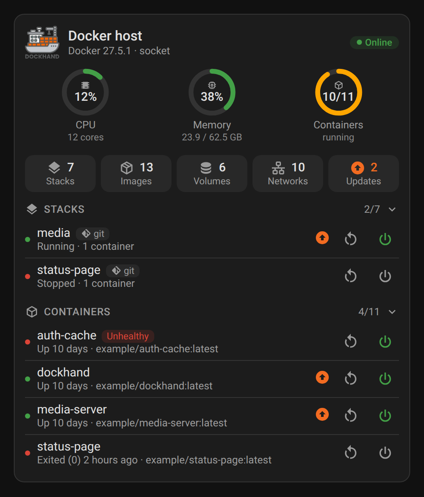 |

Containers list:

| Light | Dark |
|---|---|
|  | 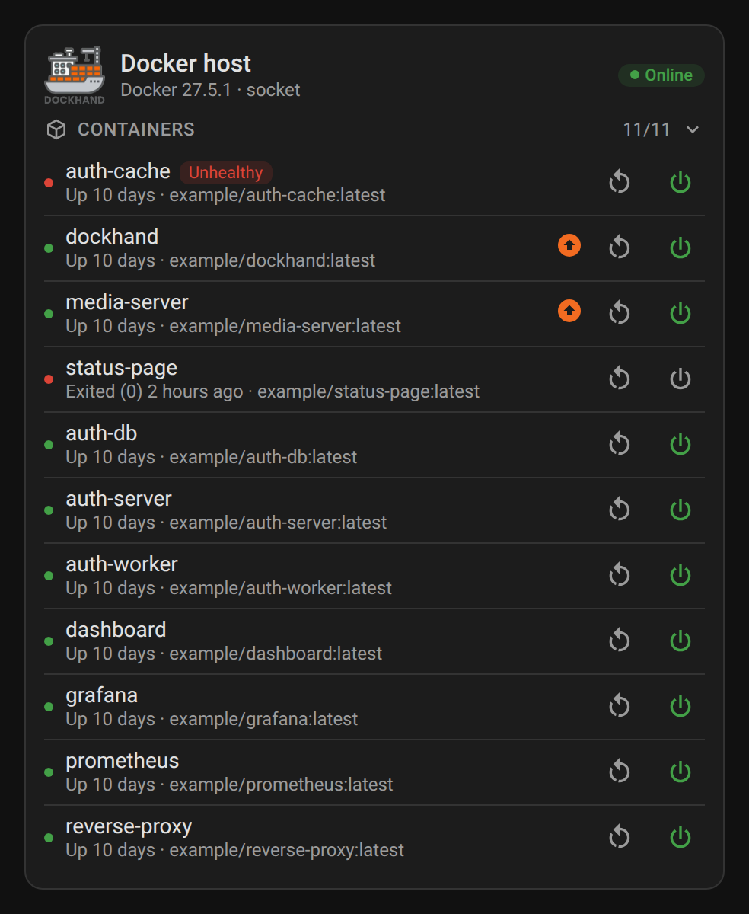 |

### Animations

| Animation | Light | Dark |
|---|---|---|
| Folding sections | 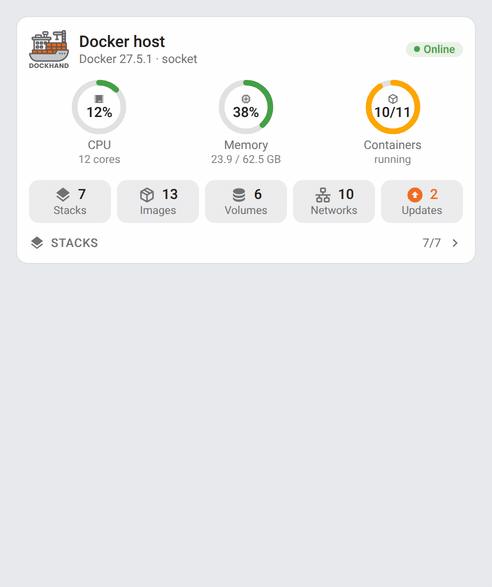 | 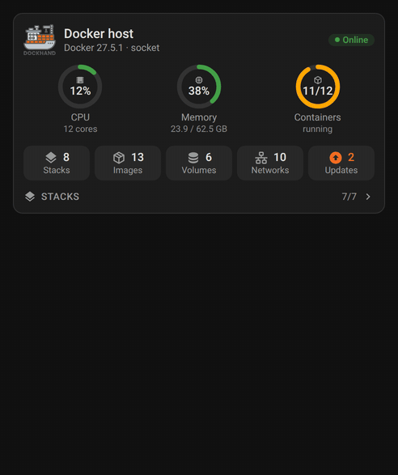 |
| Live gauges | 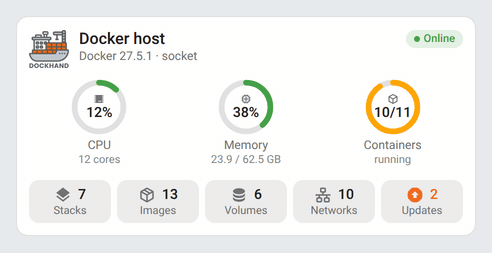 | 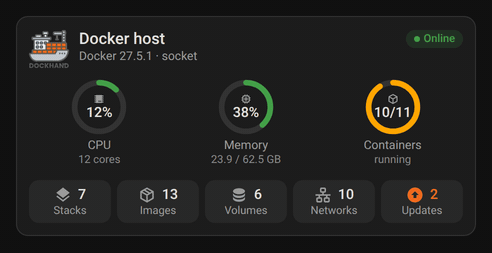 |
| Mini card detail button | 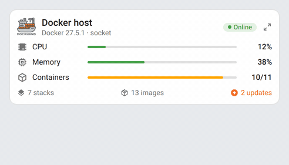 | 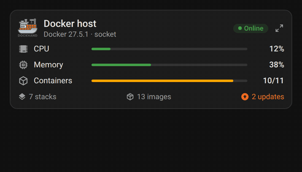 |

- `card-sections.gif` / `card-sections-dark.gif` — the stacks list folds and unfolds on a click on its title, with the chevron rotating along (the containers list, when shown, works the same way).
- `card-gauges.gif` / `card-gauges-dark.gif` — the CPU and memory rings and labels follow every state change with a smooth transition.
- `mini-card-zoom.gif` / `mini-card-zoom-dark.gif` — the detail button switches the mini card to the full card and back.

## How it works

The cards read the Home Assistant entity and device registries instead of entity ids: every entity of the Dockhand integration is matched by its `translation_key` (`cpu_usage`, `containers`, `status`, `restart`…) and by the device it belongs to (`Environment`, `Container`, `*Stack`). Entity ids can therefore be in any language or renamed without breaking the cards.

Some sensors of the integration are disabled by default (Docker version, host platform…). Enable them in Home Assistant to show them in the header.

The start / stop button uses the stack or container switch, and the restart button presses the integration's **Restart** button. Stopping and restarting ask for confirmation.

Thresholds:

| Value | Orange | Red |
|---|---|---|
| CPU usage | 70 % | 90 % |
| Memory usage | 80 % | 95 % |
| Containers | some are not running or unhealthy | — |

## Development

```bash
npm install
npm run build        # bundles src/dockhand-card.js + images/logo.webp into dist/dockhand-card.js
npm run check        # builds and checks the card (run in CI)
npm run screenshots  # renders the cards with mock data (scripts/mock-states.mjs) into screenshots/, PNG and animated GIF (needs ffmpeg)
```

The **Screenshots** workflow re-renders `screenshots/` on every pull request touching `src/`, `scripts/`, `images/` or `package-lock.json` (a Playwright/Chromium bump changes the rendering) and commits the refreshed captures onto the pull request's branch, so the README always matches the code.

`dist/` is not committed: `npm run build` creates it locally, CI builds it on every push, and the release workflow attaches the built file to the release, which is where HACS downloads it from.

### Releasing

1. Bump `version` in `package.json`
2. Add a `## <version>` section at the top of [CHANGELOG.md](CHANGELOG.md)
3. Push to `main`: the **Release** workflow builds the card, creates the tag and the GitHub release with the changelog section as notes, and attaches `dockhand-card.js`

## Translations

The cards auto-detect the language from your Home Assistant settings. Currently supported:

| Language | Code |
|---|---|
| English | `en` |
| Français | `fr` |
| Deutsch | `de` |
| Español | `es` |
| Српски | `sr` |
| Srpski (latinica) | `sr-Latn` |
| Italiano | `it` |
| Nederlands | `nl` |
| Português (European) | `pt` |
| Polski | `pl` |

Contributions for additional languages are welcome!

## Credits

The Dockhand logo comes from the [Dockhand integration](https://github.com/raetha/ha-dockhand) (MIT). Dockhand is a project by [Finsys](https://github.com/Finsys/dockhand).

## License

[MIT](LICENSE)
